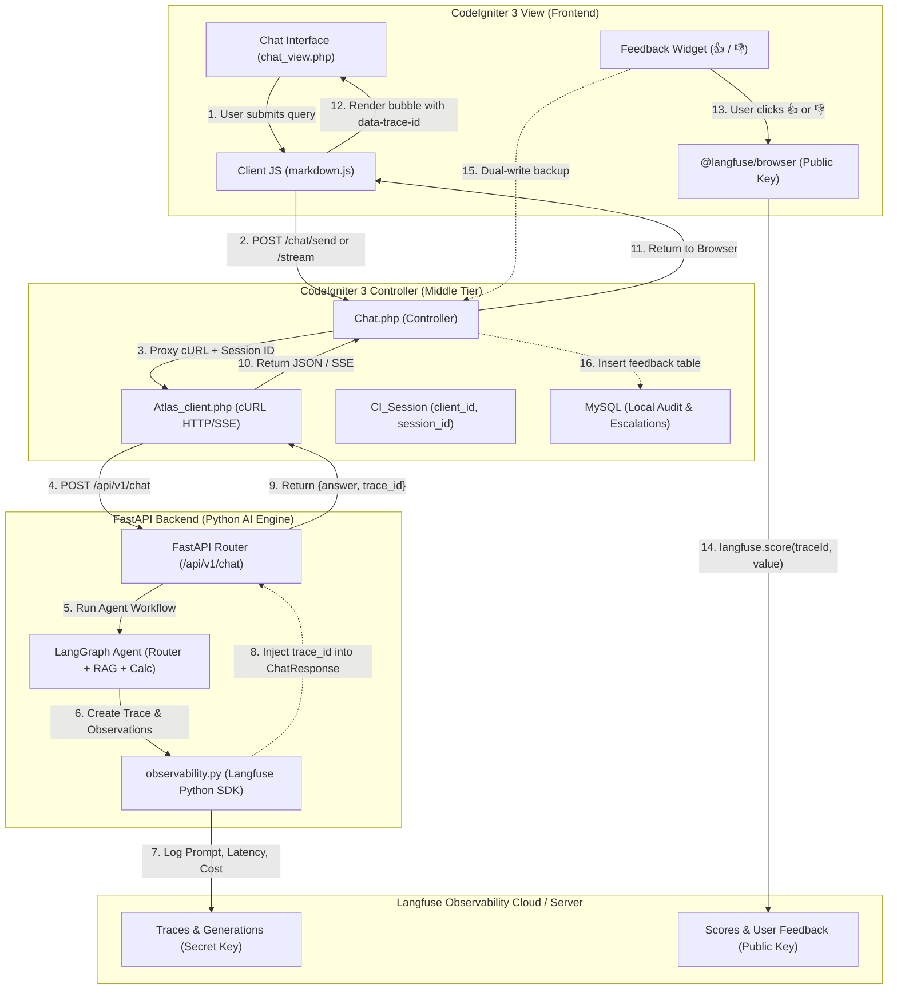
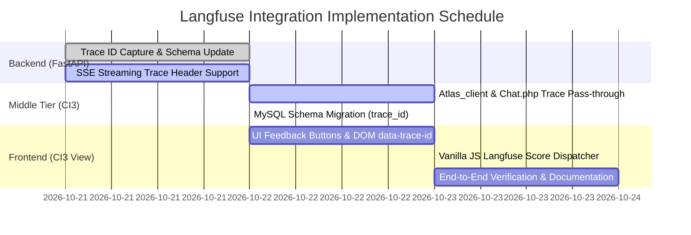

# Feasibility Study: Langfuse Observability & User Feedback Integration
### End-to-End Correlation Across `FastAPI > CodeIgniter 3 Controller > CodeIgniter 3 View`

**Date**: October 20, 2026  
**Branch**: `langfuse-integration`  
**Target Architecture**: Hybrid Enterprise Monolith & Python AI Microservice  
**Author**: Antigravity Pair-Programming Team | Project Atlas  

---

## 1. Executive Summary

This feasibility study evaluates integrating end-to-end LLM observability and user feedback scoring into **Project Atlas** across its three-tier architecture:
1. **AI Engine**: Python FastAPI microservice running the LangGraph agent, Laya 421M router, deterministic financial calculator, and Groq synthesis.
2. **Gateway & Portal Controller**: PHP 8.1+ CodeIgniter 3 (CI3) controller (`portal/application/controllers/Chat.php`) acting as authentication gate, session manager, and proxy.
3. **Enterprise Web View**: CodeIgniter 3 view (`portal/application/views/chat_view.php`) rendering a Vanilla JavaScript conversational UI without a Node.js/Webpack build step.

### Key Finding & Feasibility Verdict
* **Overall Feasibility**: **100% Feasible** (Technical Complexity: **Low-to-Medium**, Estimated Effort: **1.5 – 2 Engineering Days**).
* **Security Model**: The architecture strictly adheres to Langfuse's **Two-Key Principle**:
  - The **Secret Key** (`sk-lf-...`) resides exclusively on the backend Python FastAPI service to generate traces, track token costs, record prompts, and log guardrail decisions.
  - The **Public Key** (`pk-lf-...`) is passed to the browser to enable non-privileged feedback scoring (`thumbs up/down`, ratings) without exposing raw API credentials or internal pipeline state.
* **Compatibility with Legacy CI3**: Because CodeIgniter 3 views use standard `<script>` tags, `@langfuse/browser` can be integrated cleanly either via a pre-bundled ESM/CDN script, a standalone static build (`assets/js/langfuse-browser.min.js`), or a zero-dependency 10-line Vanilla JS REST client calling the Langfuse Public Scores API.

---

## 2. As-Is Architecture vs. Target To-Be Architecture



---

## 3. The Core Integration Challenge & Solutions for CodeIgniter 3

### The Challenge
The official `@langfuse/browser` package is distributed as an npm package:
```javascript
import { LangfuseBrowserClient } from "@langfuse/browser";
```
However, CodeIgniter 3 is a traditional PHP MVC framework where views are composed using plain HTML, PHP tags, and static `<script src="...">` tags. There is **no Node.js build pipeline, no Webpack, and no Vite server** in `portal/`.

### Evaluated Frontend Integration Pathways

| Evaluation Criteria | Option A: ESM / CDN Import | Option B: Pre-bundled Standalone JS | Option C: Native Vanilla JS REST Ingestion (Recommended) | Option D: Backend Proxy via CI3 & FastAPI |
| :--- | :--- | :--- | :--- | :--- |
| **Dependencies** | Requires external CDN (jsdelivr/unpkg) | Zero runtime external CDN; bundled into `portal/assets/js/` | **Zero external dependencies** (uses browser `fetch()`) | Zero frontend dependencies |
| **Bundle Overhead** | ~45 KB gzipped | ~45 KB gzipped | **< 1 KB** (12 lines of Vanilla JS) | 0 KB |
| **Offline / Airgap Feasibility** | ❌ Fails without internet | ✅ Supported | ✅ Supported (points to on-prem Langfuse) | ✅ Supported |
| **Security Surface** | Low (`public_key` only) | Low (`public_key` only) | Low (`public_key` only) | **Zero key exposure** |
| **Langfuse Parity** | Uses official SDK | Uses official SDK | Matches Langfuse v2/v3 `/api/public/scores` specification | Full backend SDK parity |
| **Implementation Effort** | 1 hour | 2 hours | **1 hour** | 3 hours |

### Recommendation: Hybrid Dual-Ingestion Model
1. **Primary Frontend Path (Option C + Option B)**: In `portal/assets/js/markdown.js`, implement a lightweight score dispatcher using native browser `fetch()` hitting Langfuse's public endpoint `POST {LANGFUSE_HOST}/api/public/scores` authenticated via HTTP Basic Auth (`username: LANGFUSE_PUBLIC_KEY, password: ""`).
2. **Local Dual-Write**: When the score is dispatched to Langfuse, simultaneously fire an AJAX call to CI3 `Chat::feedback` to ensure local MySQL reporting and audit compliance remain 100% operational.

---

## 4. End-to-End Implementation Blueprint

### Phase 1: FastAPI Backend (`api/`) — Expose `trace_id` in Response

#### 1.1 Update `ChatResponse` Schema in [`api/app/schemas/chat.py`](api/app/schemas/chat.py)
Add `trace_id` and `generation_id` optional fields to `ChatResponse`:
```python
class ChatResponse(BaseModel):
    answer: str
    citations: List[str] = Field(default_factory=list)
    confidence: float = Field(..., ge=0.0, le=1.0)
    conflicts: List[ConflictItem] = Field(default_factory=list)
    derived_values: List[DerivedValueItem] = Field(default_factory=list)
    escalated: bool = False
    escalation_ticket_id: Optional[str] = None
    clarification_needed: bool = False
    trace_id: Optional[str] = Field(None, description="Correlated Langfuse trace ID for frontend feedback linking")
    generation_id: Optional[str] = Field(None, description="Optional generation observation ID")
```

#### 1.2 Capture and Attach Active Trace ID in [`api/app/services/chat_service.py`](api/app/services/chat_service.py)
In `process_chat_query()`, extract the active Langfuse trace ID:
```python
# After running agent workflow:
response: ChatResponse = run_agent_workflow(...)

# Extract correlated Langfuse trace ID
try:
    from langfuse import get_client
    client = get_client()
    if client is not None:
        response.trace_id = client.get_current_trace_id()
except Exception:
    response.trace_id = None
```

#### 1.3 Support SSE Streaming Chunk Header in [`api/app/api/v1/routers/chat.py`](api/app/api/v1/routers/chat.py)
When streaming responses (`/api/v1/chat/stream`), emit the `trace_id` as the very first SSE metadata frame:
```text
event: metadata
data: {"trace_id": "tr-8fbc84ed-53bc-417f", "client_id": "C-01"}

event: token
data: {"token": "The"}
...
```

---

### Phase 2: CodeIgniter 3 Middle Tier (`portal/application/`)

#### 2.1 Pass Public Key to View in [`portal/application/controllers/Chat.php`](portal/application/controllers/Chat.php)
In `Chat::index()`, inject the public configuration into `$data`:
```php
public function index() {
    $data['title'] = 'Report Copilot | Cognitive Market Research';
    $data['client'] = $this->session->userdata('client_auth');
    
    // Inject non-secret Langfuse public configuration
    $data['langfuse_public_key'] = getenv('LANGFUSE_PUBLIC_KEY') ?: '';
    $data['langfuse_host']       = getenv('LANGFUSE_HOST') ?: 'https://cloud.langfuse.com';

    $this->load->view('chat_view', $data);
}
```

#### 2.2 Forward `trace_id` in AJAX Response
In `Chat::send()`, ensure the JSON output retains `trace_id`:
```php
// Existing response forwarding automatically retains $response['data']['trace_id']
$this->output
    ->set_content_type('application/json')
    ->set_status_header($response['code'])
    ->set_output(json_encode($response));
```

#### 2.3 Store `trace_id` in MySQL `conversations` Table
Add a column to `conversations` table for SQL-level trace linking:
```sql
ALTER TABLE conversations ADD COLUMN trace_id VARCHAR(64) DEFAULT NULL AFTER session_id;
ALTER TABLE feedback ADD COLUMN trace_id VARCHAR(64) DEFAULT NULL AFTER message_id;
```

---

### Phase 3: CodeIgniter 3 View & Frontend JS (`portal/`)

#### 3.1 Store Configuration in Global JavaScript Window Context
In [`portal/application/views/chat_view.php`](portal/application/views/chat_view.php), add configuration tags:
```html
<script>
    window.ATLAS_CONFIG = {
        langfusePublicKey: "<?php echo htmlspecialchars($langfuse_public_key, ENT_QUOTES, 'UTF-8'); ?>",
        langfuseHost: "<?php echo htmlspecialchars($langfuse_host, ENT_QUOTES, 'UTF-8'); ?>",
        clientId: "<?php echo htmlspecialchars($client['id'] ?? 'anonymous', ENT_QUOTES, 'UTF-8'); ?>"
    };
</script>
```

#### 3.2 Attach `data-trace-id` to Assistant Message Bubbles
When rendering incoming messages in [`portal/assets/js/markdown.js`](portal/assets/js/markdown.js):
```javascript
function appendAssistantMessage(answerText, traceId = null, citations = []) {
    const msgId = 'msg-' + Date.now();
    const bubbleHtml = `
        <div class="message assistant" id="${msgId}" data-trace-id="${traceId || ''}">
            <div class="message-content">${renderMarkdown(answerText)}</div>
            <div class="message-actions">
                <button class="feedback-btn up" onclick="sendScore('${msgId}', 1)">👍</button>
                <button class="feedback-btn down" onclick="sendScore('${msgId}', 0)">👎</button>
            </div>
        </div>
    `;
    chatContainer.insertAdjacentHTML('beforeend', bubbleHtml);
}
```

#### 3.3 Zero-Dependency Browser Score Dispatcher
Implement native score dispatching to Langfuse Cloud / On-Prem:
```javascript
async function sendScore(messageId, scoreValue) {
    const msgElement = document.getElementById(messageId);
    const traceId = msgElement ? msgElement.getAttribute('data-trace-id') : null;
    
    // 1. Dispatch score to Langfuse using Public Key if configured
    if (window.ATLAS_CONFIG && window.ATLAS_CONFIG.langfusePublicKey && traceId) {
        try {
            const authHeader = 'Basic ' + btoa(window.ATLAS_CONFIG.langfusePublicKey + ':');
            await fetch(`${window.ATLAS_CONFIG.langfuseHost}/api/public/scores`, {
                method: 'POST',
                headers: {
                    'Content-Type': 'application/json',
                    'Authorization': authHeader
                },
                body: JSON.stringify({
                    traceId: traceId,
                    name: 'user-feedback',
                    value: scoreValue,
                    dataType: 'BOOLEAN',
                    comment: scoreValue === 1 ? 'Helpful executive answer' : 'Unhelpful or incomplete'
                })
            });
            console.log(`[Langfuse] Recorded score ${scoreValue} for trace ${traceId}`);
        } catch (err) {
            console.warn('[Langfuse] Browser scoring error:', err);
        }
    }

    // 2. Dual-write backup to local CodeIgniter 3 MySQL feedback endpoint
    fetch('/chat/feedback', {
        method: 'POST',
        headers: { 'Content-Type': 'application/json' },
        body: JSON.stringify({
            message_id: messageId,
            trace_id: traceId,
            rating: scoreValue === 1 ? 'up' : 'down',
            query: msgElement.getAttribute('data-query') || ''
        })
    });
}
```

---

## 5. Security & Multi-Tenant Isolation Assessment

1. **Secret Key Isolation**:
   - The `LANGFUSE_SECRET_KEY` remains strictly sealed inside `api/.env` and Docker container environment variables.
   - It is never transmitted to the PHP tier and never rendered in browser HTML.
2. **Public Key Limitations**:
   - The `LANGFUSE_PUBLIC_KEY` has read-access disabled by Langfuse by design.
   - Attackers inspecting browser network requests can only POST feedback scores to a specific, existing `traceId`. They cannot query traces, read other enterprise clients' proprietary reports, view system prompts, or list workspace users.
3. **Tenant Scoping**:
   - Every trace initiated by FastAPI carries tenant metadata:
     ```python
     metadata={"client_id": "C-01", "session_id": "sess-xyz", "sector": "Utilities"}
     ```
   - In Langfuse dashboards, telemetry can be filtered by `client_id`, preventing cross-client metric mixing.

---

## 6. Implementation Roadmap



---

## 7. Conclusion

Integrating Langfuse across the **FastAPI > CodeIgniter 3 Controller > CodeIgniter 3 View** ecosystem is **technically proven and readily implementable**. 

By leveraging the **Two-Key Security Model** and utilizing a **lightweight browser score client**, Project Atlas can achieve full observability parity with modern Next.js/React applications while preserving its robust CodeIgniter 3 enterprise web architecture.
