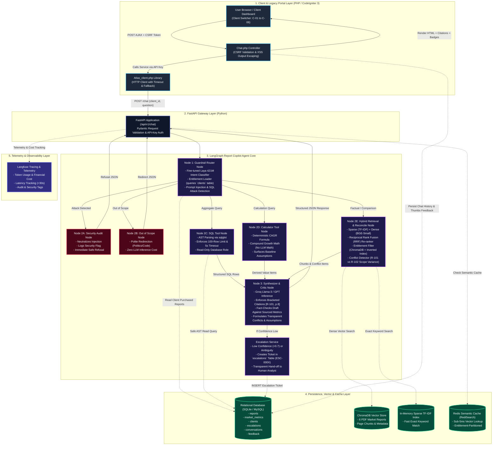

# Project Atlas - Report Copilot

Agentic AI Assistant & Report Copilot for Cognitive Market Research and Consulting. Built with FastAPI, LangGraph, CodeIgniter 3, and MySQL.

---

## 🏛 Architecture Overview

Project Atlas orchestrates an entitlement-aware multi-step agent workflow to analyze market research reports, detect conflicting metrics, safely query structured SQL databases, and calculate derived market projections with full citations and guardrails.




---

## 🚀 Key Features & Edge Case Handling

1. **Entitlement-Aware RAG**:
   - Clients only retrieve data from reports they have purchased (filtered at vector database query time).
   - If a client asks for unpurchased reports, the copilot reports existence and provides an upgrade path without leaking underlying figures.

2. **Conflict Detection & Scope Differentiation**:
   - Compares metrics across multiple sources (e.g., hardware-only vs total market scope).
   - Shows differences transparently without averaging or hallucinating consensus.

3. **Missing / Derived Values**:
   - Computes market projections using deterministic formulas (e.g., CAGR compounding) with explicit assumptions and base-year caveats.
   - Clearly flags numbers as *derived estimates*, not quoted facts.

4. **Security & Prompt Injection Defenses**:
   - Detects and logs instruction-like text embedded in retrieved reports, removes those instruction fragments before LLM synthesis, and preserves surrounding report facts.
   - Validates numeric claims in retrieval-grounded answers against citations to exact retrieved report pages before streaming any answer tokens; unsupported claims are withheld and escalated for human review.
   - Restricts agent-generated SQL to a dedicated read-only account, enforces a 100-row cap and database-native query deadline, and keeps escalation/feedback writes on a separate transactional role.
   - Blocks projections that would rely on an unpurchased R-101 baseline and escalates requests beyond the available 2030 forecast horizon.

5. **Human-in-the-Loop Escalation**:
   - Automatically escalates queries to human analysts via MySQL support tickets if model confidence falls below threshold.

6. **Observability & Monitoring**:
   - End-to-end tracing, token usage, latency tracking, and request cost auditing via Langfuse / LangSmith.

7. **Hybrid Retrieval & Semantic Re-Ranker (Sparse TF-IDF + Dense Vector + RRF + Cross-ReRanker)**:
   - Combines sub-millisecond sparse lexical retrieval (TF-IDF inverted index) with dense semantic embeddings (`BAAI/bge-small-en-v1.5` in ChromaDB).
   - Pools candidate sets via Reciprocal Rank Fusion (RRF, $k=60$) and executes a 2nd-stage Semantic Cross-ReRanker evaluating exact entity metrics, term proximity window density, and direct cosine cross-similarity.
   - Enforces strict entitlement boundaries across both sparse and dense retrieval pipelines.

8. **Multimodal Chart Extraction & Visual Ground Truth**:
   - Uses PyMuPDF to extract high-resolution vector and raster charts directly from report pages.
   - Employs Gemini Flash Lite vision model to convert visual graphics, donut slice distributions, and trajectory projections into structured, verifiable Markdown tables.
   - Ingests visual ground-truth evidence chunks into ChromaDB and the sparse inverted index for direct retrieval and citation.

---

## 🛠 Tech Stack

- **Agent Engine**: LangGraph & Python 3.11+
- **API Service**: FastAPI (Typed Pydantic Models, Async)
- **Portal & Frontend**: CodeIgniter 3 (PHP)
- **Database**: Shared MySQL 8.0 database (with SQLite fallback) for the FastAPI agent and CI3 portal
- **Database roles**: Read-write credentials for application/portal writes; read-only credentials for agent SQL and health probes
- **Vector & Lexical Search**: ChromaDB (Dense FastEmbed) + In-Memory TF-IDF + Reciprocal Rank Fusion (RRF)
- **Vision & Multimodal**: PyMuPDF + Gemini Flash Lite (Visual Ground Truth)
- **Observability**: Langfuse / LangSmith
- **Containerization**: Docker Compose

### Database transactions and access roles

The portal and FastAPI use the same `project_atlas` MySQL database. Portal and
FastAPI application writes use the configured read-write account, which is
limited to `SELECT`, `INSERT`, `UPDATE`, and `DELETE`, and commit as transactions;
failed writes are rolled back. MySQL's InnoDB engine supplies row-level locking
while a transaction writes. The agent's natural-language SQL tool and the health
probe use a distinct account granted `SELECT` only. AST validation is an
additional guard, not a replacement for MySQL privileges.

Current application writes append feedback/escalation records, so there is no
read-modify-write race that needs an explicit `SELECT ... FOR UPDATE`. Any
future operation that reads a row and then updates it must take that lock inside
the same transaction.

Create `.env` from `.env.example` and set unique values for both database
accounts, the root password, and API keys. Compose provisions the application account with CRUD privileges and the
read-only account with `SELECT` only before starting FastAPI or the portal.
An existing MySQL volume is preserved; this role setup runs on every Compose
start so the read-only account can also be established on an existing database.

### Run locally (Windows / PowerShell)

Prerequisites: Docker Desktop is installed and running with Linux containers
enabled. The default Compose database is an isolated MySQL container; it does
not automatically use a MySQL server installed on Windows.

1. From the repository root, create your local environment file:

   ```powershell
   Copy-Item .env.example .env
   notepad .env
   ```

2. Set non-empty, unique values for `API_KEY`, `GROQ_API_KEY`,
   `MYSQL_ROOT_PASSWORD`, `MYSQL_USER`, `MYSQL_PASSWORD`,
   `MYSQL_READONLY_USER`, and `MYSQL_READONLY_PASSWORD`. Use distinct database
   usernames and passwords; do not use the MySQL root account as the app user.
   The same `API_KEY` is forwarded to both FastAPI and the portal. Leave
   `FASTAPI_URL=http://api:8000` for the Compose setup.

   `MYSQL_HOST_PORT` controls the host-side port exposed for the Compose MySQL
   service. The example uses `3307` to avoid colliding with an existing local
   MySQL server listening on `3306`. Container-to-container traffic continues
   to use the internal MySQL port `3306`.

3. Validate Compose configuration and start the full stack:

   ```powershell
   docker compose config --quiet
   docker compose up --build -d
   ```

4. Check service startup and health:

   ```powershell
   docker compose ps
   Invoke-RestMethod http://localhost:8000/health
   ```

   Open the portal at <http://localhost:8080/index.php/chat> and FastAPI docs
   at <http://localhost:8000/docs>. Wait for the API and database health checks
   to pass before sending a chat request.

5. Follow logs while testing:

   ```powershell
   docker compose logs -f --tail 100 db db-roles api portal
   ```

   Stop with `Ctrl+C`, then stop the stack without deleting its database volume:

   ```powershell
   docker compose down
   ```

   Do not add `-v` unless you explicitly intend to erase the Compose MySQL data.

If `docker compose up` reports that a port is already allocated, check the
ports in `docker-compose.yml`. For a conflict on host port 3306, set
`MYSQL_HOST_PORT=3307` in `.env` and retry. A host MySQL server and the Compose
MySQL container are separate databases: the project schema is created in the
Compose database when its volume is initialized. To confirm that schema is
present, run:

```powershell
docker compose exec db mysql -uroot -p -e "SHOW DATABASES LIKE 'project_atlas';"
```

Enter the `MYSQL_ROOT_PASSWORD` value from `.env` at the prompt; do not put the
password directly in the command.

The portal forwards `API_KEY` as `ATLAS_API_KEY` to FastAPI. If running FastAPI
outside Compose while the portal remains containerized, both processes must use
the same `API_KEY`: set it in the repository-root `.env` for the local API and
in the environment used to start the portal container. FastAPI rejects missing
or mismatched keys; it never logs the key itself. Each API response includes an
`X-Request-ID`, and backend/portal logs record that ID with request status and
failure category so a failed stream can be correlated without logging its
question text.

For a host-run API with a containerized portal, set `FASTAPI_URL` to
`http://host.docker.internal:8888` and keep the API process running on
`0.0.0.0:8888`. Because `db` is only resolvable inside the Compose network,
the host-run API must connect to the host MySQL instance instead. If that
database is listening on the default port, start FastAPI from the `api`
directory in PowerShell with:

```powershell
$env:MYSQL_HOST = "127.0.0.1"
$env:MYSQL_PORT = "3306"
uv run uvicorn app.main:app --host 0.0.0.0 --port 8888
```

The root `.env` must also contain the API key, model key, and the application
and read-only MySQL credentials provisioned in the host database. These
PowerShell overrides apply only to this terminal session. For a fully
Compose-managed stack, use `http://api:8000`; Compose sets the API's database
host to `db` automatically.
The API's `/health` route confirms reachability but does not authenticate;
authenticated chat requests return `403` for a missing/mismatched key and
`503` when the API itself has no key configured. A portal `502`/`503` instead
points to a connection/configuration problem between CI3 and FastAPI. The
portal's CI3 error log is enabled at error level under
`portal/application/logs/`; Apache access logs also show the HTTP status.
FastAPI uses `LOG_LEVEL` (`INFO` by default; set `DEBUG` for local diagnosis)
and emits request IDs, status codes, durations, and categorized dependency or
agent failures. Logs intentionally omit API/database passwords and raw chat
questions. For a single request, correlate the `X-Request-ID` response header
with API and portal logs.

### Streaming chat responses

The CI3 chat view uses browser `fetch()` with a readable response stream. The
request travels through the CI3 `chat/stream` controller, which proxies
FastAPI's `POST /api/v1/chat/stream` Server-Sent Events response without
buffering it. Tokens appear as the model generates them; a final event carries
the normal structured answer, citations, confidence, conflicts, and derived
values so the existing response UI can render its metadata. The existing
non-streaming `POST /api/v1/chat` endpoint remains available.

Streaming requires a browser that supports Fetch Streams, FastAPI/ASGI, PHP
cURL, and a web server configuration that does not buffer the response. The
portal Docker image installs PHP's cURL extension. If a reverse proxy is added,
it must also have response buffering disabled for this route.

The API tests use mocked MySQL connections by default. One MySQL-role
integration test is skipped by default because it requires a dedicated test
database and explicit opt-in; it is not skipped merely because you only have a
root account. To run it, set
`ATLAS_MYSQL_INTEGRATION_TESTS=1` and the `ATLAS_MYSQL_TEST_HOST`,
`ATLAS_MYSQL_TEST_DATABASE`, `ATLAS_MYSQL_TEST_READONLY_USER`, and
`ATLAS_MYSQL_TEST_READONLY_PASSWORD` environment variables before running
`pytest api/tests/test_services/test_mysql_role_integration.py`.


````mermaid
flowchart TD
    User([User Query + Client ID]) --> Intent[1. Laya / Router Node]
    
    subgraph LangGraph_Agent [LangGraph State Machine Engine]
        Intent -->|prompt_injection / sql_attack| SecurityAudit[Security Log & Escalation]
        Intent -->|factual_lookup / comparison| RetrieverNode[2. LlamaIndex Retriever]
        Intent -->|database_aggregate| SQLTool[3. AST SQL Query Tool]
        Intent -->|calculation| CalcEngine[4. Python Math Engine]
        
        RetrieverNode --> ReconcileNode[Conflict Detection Node]
        ReconcileNode --> SynthesizerNode[LLM Response Generation]
        SQLTool --> SynthesizerNode
        CalcEngine --> SynthesizerNode
    end
    
    SynthesizerNode --> FinalOutput([Structured JSON Response])
    
    subgraph Observability [Langfuse Tracing]
        LangGraph_Agent -.->|Logs spans, latency, token usage, guardrail blocks| Langfuse[(Langfuse Dashboard)]
    end
````

Loading fine-tuned Laya model...

Validation Complete! Average Inference Latency: 37.22 ms

--- Classification Report ---
                    precision    recall  f1-score   support

       calculation     0.9375    1.0000    0.9677        30
        comparison     1.0000    0.9667    0.9831        30
database_aggregate     0.9667    0.9667    0.9667        30
    factual_lookup     0.9286    0.8667    0.8966        30
      out_of_scope     0.9655    0.9333    0.9492        30
  prompt_injection     0.9375    1.0000    0.9677        30
        sql_attack     1.0000    1.0000    1.0000        30

          accuracy                         0.9619       210
         macro avg     0.9623    0.9619    0.9616       210
      weighted avg     0.9623    0.9619    0.9616       210
